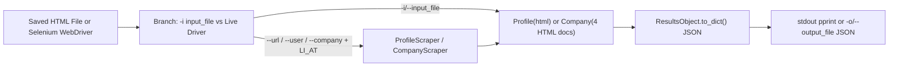

# scrape_linkedin

A Python package and Click CLI (`scrapeli`) for extracting structured JSON from LinkedIn personal profile and company HTML documents using BeautifulSoup and Selenium (`master` fork of `austinoboyle/scrape-linkedin-selenium`).

> **Documentation Portal:** [docs/index.md](docs/index.md) ([Tutorials](docs/01-tutorials/index.md), [How-To Guides](docs/02-how-to-guides/index.md), [Reference](docs/03-reference/index.md), [Explanation](docs/04-explanation/index.md)) | [Examples](examples/companies-to-csv.py) | [License](LICENSE)

**Compliance & Responsible Use Notice:** LinkedIn enforces strict anti-scraping controls and Terms of Service restrictions, and may block IP addresses or accounts making automated or unauthenticated requests. Never attempt to bypass authentication, CAPTCHA, or anti-bot protections, and never commit `LI_AT` session cookies or credentials to source control. Use saved local HTML fixtures for offline parser development, tutorials, and automated testing.

## Architecture Overview



## Installation

Install directly from this fork over HTTPS or from a local clone:

```bash
pip install git+https://github.com/jmrenouard/scrape-linkedin-selenium.git
```

Install editable or standard from a local checkout:

```bash
git clone https://github.com/jmrenouard/scrape-linkedin-selenium.git
cd scrape-linkedin-selenium
pip install .
```

> **Note:** Importing top-level `scrape_linkedin` currently imports `selenium` and `joblib` (`requirements.txt`). When running offline HTML parser checks in environments without Selenium installed, see [docs/04-explanation/architecture-selector-drift-and-compliance.md](docs/04-explanation/architecture-selector-drift-and-compliance.md).

## Usage

### Command Line (`scrapeli`)

`scrape_linkedin/cli.py` registers the `scrapeli` console script via Click. Supported options verified against `scrape_linkedin/cli.py`:

- `--url TEXT`: Full URL of a personal profile or URL target to scrape
- `--user TEXT`: Username slug (`https://www.linkedin.com/in/<user>`)
- `--company TEXT`: Company ID (`https://www.linkedin.com/company/<company>/`)
- `-a, --attribute [personal_info|experiences|skills|accomplishments|interests|recommendations]`: Extract one `Profile` attribute instead of calling `to_dict()`
- `-i, --input_file PATH`: Path to a local HTML file (used directly with `Profile`, no browser or `LI_AT` required)
- `--headless`: Enable `HEADLESS_OPTIONS` for headless Chrome scraping
- `-o, --output_file PATH`: Write extracted JSON output to a file instead of printing with `pprint`
- `--driver [Chrome|Firefox]`: Selenium WebDriver class (default: `Chrome`)
- `--help`: Show CLI help and exit (Click only enables `--help`, not `-h`)

Parse an offline profile HTML snapshot safely without network access:

```bash
scrapeli --help
scrapeli -i test/html_files/profile.html -a skills -o skills.json
```

### Authentication (`LI_AT`) for Live Browser Sessions

When using `ProfileScraper`, `CompanyScraper`, `ConnectionScraper`, or `MyConnectionScraper` against live pages, supply a valid `LI_AT` cookie via environment variable or constructor keyword:

```bash
export LI_AT="YOUR_LI_AT_VALUE"
```

In Python, passing `cookie=...` overrides `LI_AT` from the environment:

```python
from scrape_linkedin import ProfileScraper

with ProfileScraper(cookie="YOUR_LI_AT_VALUE") as scraper:
    profile = scraper.scrape(user="austinoboyle")
print(profile.to_dict())
```

### Offline HTML Parsing (`Profile` and `Company`)

`Profile(html)` parses a saved HTML string or file stream across `6` attributes (`personal_info`, `experiences`, `skills`, `accomplishments`, `interests`, `recommendations`):

```python
from scrape_linkedin import Profile

with open("test/html_files/profile.html", "r", encoding="utf-8") as profile_file:
    profile = Profile(profile_file.read())

print(len(profile.skills))
print(len(profile.experiences["jobs"]))
```

`Company(overview, jobs, life, insights)` takes **4 HTML arguments** (`overview`, `jobs`, `life`, `insights`) and exposes `4` properties (`overview`, `jobs`, `life`, `insights`). Note that `jobs` and `life` currently return `None`, while `overview` stores extracted `<dl>` metadata fields inside `overview["metadata"]`:

```python
from scrape_linkedin import Company

with open("test/html_files/facebook_overview.html", "r", encoding="utf-8") as overview:
    company = Company(overview.read(), "", "", "")

print(company.overview)
print(company.insights)
```

For full attribute schemas (`personal_info`, `experiences`, `accomplishments`, `overview`, `insights`) and `Scraper` constructor parameters (`cookie`, `driver`, `driver_options`, `scroll_pause`, `scroll_increment`, `timeout`), see [docs/03-reference/cli-api-and-parser-matrix.md](docs/03-reference/cli-api-and-parser-matrix.md).

## Parallel Scraping (`scrape_in_parallel`)

For batch scraping with pre-configured `selenium` + `joblib`:

```python
from scrape_linkedin import CompanyScraper, scrape_in_parallel

companies = ["facebook", "linkedin"]
scrape_in_parallel(
    scraper_type=CompanyScraper,
    items=companies,
    output_file="companies.json",
    num_instances=2,
)
```

Also review [examples/companies-to-csv.py](examples/companies-to-csv.py) for pandas CSV export of company overviews.

## Testing & Known Suite Status

Offline documentation, CLI, compilation, and HTML-fixture verification tests live under `tests/` and run with standard library `unittest` (no Chrome driver or network access required):

```bash
python -B -m unittest discover -s tests -p "test_*.py" -v
```

Legacy upstream `test/` modules retain older fixture/selector assumptions documented in [docs/03-reference/cli-api-and-parser-matrix.md](docs/03-reference/cli-api-and-parser-matrix.md) (`test/scrapers_test.py` requires live Chrome/LinkedIn, `test/parsers_test.py` targets older HTML DOM selectors and 3-arg `Company(...)`, and `test/utils_test.py` tests `.1` CSS syntax rejected by `soupsieve` in `beautifulsoup4>=4.7`).
