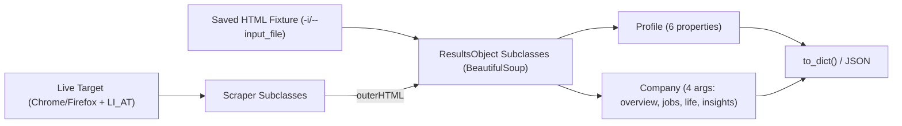

# Architecture, Selector Drift, and Compliance

This page explains how HTML acquisition is decoupled from HTML extraction, why legacy fixtures fail header checks under modern selectors, and why tests stay strictly offline.

## Decoupled Acquisition and Parsing

`scrape_linkedin` splits scraping into two layers: Selenium subclasses (`Scraper`, `ProfileScraper`, `CompanyScraper`) handle authenticated browser navigation and dynamic scrolling, while `ResultsObject` subclasses (`Profile`, `Company`) apply CSS selectors in BeautifulSoup against raw HTML text.

Note that `scrape_linkedin/__init__.py` imports `CompanyScraper`, `ProfileScraper`, and `utils` (which imports `selenium.webdriver.chrome.options.Options`) at package initialization time. Consequently, running `Profile` or `Company` purely offline on minimal systems requires either `selenium` + `joblib` installed or mocked `sys.modules` stubs during testing.

## Why Legacy Tests Drift Against Shipped HTML Fixtures

1. **Profile top-card selector updates (`Profile.py` vs `test/html_files/profile.html`):** Upstream commits updated `Profile.personal_info` to target `.pv-top-card h1` and `img.pv-top-card__photo`. The older 2018 HTML snapshot in `test/html_files/profile.html` still parses `39` skills and `8` jobs, but omits the newer `.pv-top-card` header markup, leaving `personal_info["name"]` as `None`.
2. **Four-argument `Company` evolution (`Company.py` vs `test/parsers_test.py`):** Adding LinkedIn Insights changed `Company.__init__` to accept `(overview, jobs, life, insights)` and grouped `<dl>` metadata under `overview["metadata"]`, breaking the older `3`-argument assertion in `test/parsers_test.py`.
3. **Modern `soupsieve` CSS compliance (`test/utils_test.py`):** Starting with `beautifulsoup4>=4.7`, CSS selectors beginning with digits such as `.1` in `test/utils_test.py` raise parser errors caught by `text_or_default`.

## Compliance and Anti-Bot Boundaries

Automated verification avoids live `linkedin.com` sessions (`test/scrapers_test.py`) for three engineering and policy reasons:

- Reproducing headless Chrome runs with valid `LI_AT` cookies in CI leaks credentials and violates LinkedIn automated-access and Terms of Service controls.
- Tests must never solve CAPTCHAs, simulate human verification challenges, or bypass bot gates.
- Validating HTML extractors and `scrapeli -i` CLI paths on synthetic and archived offline HTML snapshots provides fast, deterministic, side-effect-free coverage across Windows and Linux.

See [CLI, API, and Parser Reference](../03-reference/cli-api-and-parser-matrix.md) for the verified option tables and baseline status matrix.
