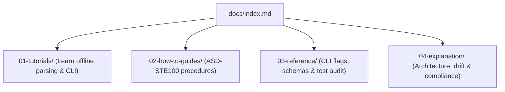

# scrape-linkedin-selenium Documentation

Welcome to the documentation portal for **scrape-linkedin-selenium**, organized under the [Diataxis](https://diataxis.fr/) framework.

## Documentation Map

## Quadrants

| Quadrant | Purpose | Entry Point |
| :--- | :--- | :--- |
| **Tutorials** | Learning-oriented offline parsing exercises using HTML fixtures | [01-tutorials/index.md](01-tutorials/index.md) |
| **How-To Guides** | Step-by-step operational procedures verified under ASD-STE100 Issue 9 | [02-how-to-guides/index.md](02-how-to-guides/index.md) |
| **Reference** | Exact `scrapeli` CLI flags, `Profile`/`Company` fields, and `test/` audit matrix | [03-reference/index.md](03-reference/index.md) |
| **Explanation** | Design decisions, DOM selector drift, and Terms of Service boundaries | [04-explanation/index.md](04-explanation/index.md) |

Related project root files: [README.md](../README.md) | [examples/companies-to-csv.py](../examples/companies-to-csv.py) | [LICENSE](../LICENSE)
